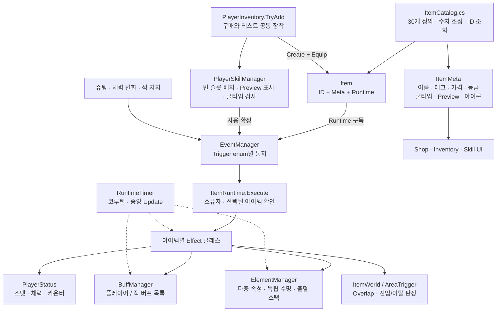

# 아이템 시스템

CSV 30개 항목을 `ItemCatalog → Item → ItemRuntime → 전용 Effect` 구조로 구현했다.
액티브 15개, 패시브 15개이며 아이템 ID는 CSV의 문자열 `"1"`부터 `"30"`까지다.
아이템 코드의 네임스페이스는 `Ujam.Runtime.Item`이다.

## 전체 흐름



`Item`, `ItemMeta`, `ItemRuntime`, `ItemEffect`는 일반 C# 객체다.
Unity의 입력·물리·프레임 갱신이 필요한 Player 컴포넌트, RuntimeTimer, AreaTrigger, DecoyController, ItemVfx, ItemCastVfx는 MonoBehaviour를 사용한다.

## 가장 먼저 수정할 곳

- 정의와 수치: `Assets/_Project/_Scripts/Item/Core/ItemCatalog.cs`
- 액티브 동작: `Item/Effect/Active/<아이템명>Effect.cs`
- 패시브 동작: `Item/Effect/Passive/<아이템명>Effect.cs`
- 공통 시스템: `Assets/_Project/_Scripts/Systems/`
- 장착 확인: `Assets/_Project/_Scripts/Test/ItemPipelineTester.cs`

새 아이템은 전용 Effect 클래스 하나를 만들고, Catalog의 `definitions`에 다음 형태로 추가한다.
기존 아이템의 반경·피해·확률·지속시간은 Effect 파일을 수정하지 않고 Catalog 생성자 인자에서 조정한다.

```csharp
new Item("31",
    new ItemMeta("새 아이템", "스킬, 원형",
        price: 100, cooldown: 10f, grade: 1,
        kind: ItemKind.Active, target: ItemTarget.Enemies,
        preview: new ItemPreview(ItemPreviewType.Circle, 8f),
        description: "아이템 설명"),
    new ItemRuntime(ItemTrigger.SkillUse,
        new NewItemEffect(radius: 2f, damagePercent: 150f)))
```

`ItemMeta`에 나중에 필드를 추가해도 Effect와 UI의 역할은 분리되어 있다.
`ItemSprite`는 아이템 이미지이고 `ActiveSkillIcon`이 없거나 Unity에서 파괴된 참조이면 `SkillIcon`이 아이템 이미지로 대체한다.

```csharp
ItemMeta meta = ItemCatalog.GetMeta("11");    // UI 조회
ItemRuntime config = ItemCatalog.GetRuntime("11"); // Trigger/Effect 설정 조회
Item owned = ItemCatalog.Create("11");        // 새 보유 개체
inventory.TryAdd("11");                       // 실제 획득 + 장착 + 빈 스킬칸 배치
inventory.TryRemove("11");                    // 해제 + 보유 목록에서 삭제
```

`Get`도 `Create`처럼 새 보유 개체를 반환한다. `Item011`, `Item_011`도 `11`로 조회된다.
같은 ID의 Meta와 불변 Effect 설정은 공유하지만, Item과 Runtime은 매번 새로 생성한다.
따라서 **Effect 필드에는 readonly 설정값만 두고**, 사용 횟수는 PlayerStatus에 Item 개체를 키로 저장한다.
시전 한 번의 대상 목록은 코루틴 지역 변수에 둔다.

직접 연결하는 경우 `Item.Equip(player, enemyMask)` / `Item.Unequip()`을 사용할 수 있다.
일반 획득은 Inventory API를 사용해야 보유 수량과 스킬 슬롯도 함께 갱신된다.

## 발동과 시전 책임

| 발신 지점 | Trigger | 용도 |
|---|---|---|
| Item.Equip | Equipped | 최대 체력, 쿨타임 감소 등 보유 효과 |
| PlayerShooter | Shooting | 기본 공격 직후 추가 효과. 빗나가면 Enemies = null |
| PlayerShooter | ShootingResolved | 슈팅과 즉시 추가 피해의 실제 합계 확정 후 흡혈 |
| PlayerSkillManager | SkillUse | 쿨타임·생존·장착 검사를 통과한 선택 슬롯의 시전 |
| 액티브 Effect의 ReportHits | SkillHit | 실제 맞은 적 목록. 지연 공격도 같은 SkillCast 유지 |
| PlayerStatus | HealthChanged | 현재/최대 체력 스냅샷 통지. 피해·회복·최대 체력 변경 |
| PlayerStatus | BeforeDeath | GameOver 판정 전에 1회 부활 처리 |
| EnemyBase | EnemyKilled | 플레이어가 처치한 적의 위치와 대상 통지 |

장착하면 해당 enum 이벤트에 Runtime.Execute가 구독되고, 해제하면 구독이 제거된다.
액티브는 이벤트의 SkillItem이 자신인 경우만 실행된다.
해제 시 진행 중인 코루틴, 생성한 장판·미끼·VFX, 자신이 부여한 플레이어 버프를 정리한다.
이미 적에게 전달된 속성은 ElementManager가 남은 수명을 관리한다.

`ItemMeta.Preview`가 시전 방식과 표시 설정의 기준이다. Catalog에서 다음처럼 지정한다.

```csharp
preview: new ItemPreview(ItemPreviewType.None)                   // Preview 없이 즉시 시전
preview: new ItemPreview(ItemPreviewType.Circle, 8f)              // X=8, Z=8, 기본 +Z 방향
preview: new ItemPreview(ItemPreviewType.Rectangle, 10f, 2f)      // X=10, Z=2, 기본 +Z 방향
preview: new ItemPreview(ItemPreviewType.Rectangle, 10f, 2f,
    direction: UnityEngine.Vector3.right)                       // +X 방향
```

스케일 하나는 X/Z 모두에 적용하고, 두 개는 각각 X/Z에 적용한다.
값은 Preview 루트의 `Transform.localScale`에 직접 대입하며 Y 스케일은 유지한다.
반경이나 칸 수가 아니고, 기존 프리팹 스케일에 다시 곱하지 않으며 Grid 크기로 자동 환산하지 않는다.
따라서 직사각형 프리팹의 기본 Z=3도 지정한 Z 값으로 덮어쓴다.
방향은 월드 XZ 평면 기준이며 기본값은 +Z다. 마우스 방향을 자동 추적하는 설정은 아니다.

`None`이면 `CastType`은 `Instant`, `Circle`/`Rectangle`이면 `Normal`로 결정된다.
별도 `castType` 생성자 인자를 두지 않아 Preview 종류와 시전 방식이 어긋나지 않는다.
`PlayerSkillManager`는 종류에 맞는 프리팹을 선택하고 Meta의 스케일·방향을 전달한다.
Preview 위치는 대상에 따라 마우스의 지면 위치 또는 플레이어 위치를 따르며,
좌클릭 시 `ConfirmUse(slot, position)`으로 확정하고 우클릭/Esc/같은 슬롯 재입력으로 취소한다.
Effect의 `PreviewRadiusCells`는 사용하지 않는다.

현재 Catalog 초기값은 기존 전투 씬의 칸 크기 2에 맞춘 월드 표시 크기다.
화염구는 12, 약화·안개·중력장·낙뢰·돌풍은 8, 냉각은 4, 파도는 X=10/Z=2다.
Effect의 실제 판정 반경·폭은 계속 칸 단위이므로 Grid 크기나 판정 수치를 바꿀 때는 Preview 값도 함께 조정한다.
Preview 방향 설정은 실제 판정 방향을 바꾸지 않는다.
연결된 Item VFX는 같은 Preview 방향을 사용한다.
CSV의 1초/2초 지연은 시전 확정 이후의 효과 지연이다.
쿨타임 감소율은 시전 시작 시 반영하며 이미 진행 중인 쿨타임은 다시 계산하지 않는다.

`PlayerSkillPreview`는 프리팹에 붙어 스케일·방향·지면 오프셋·가시성을 적용한다.
기존 `PlayerSkill`/`LightningSkill` 클래스는 남아 있지만 현재 Item 시전 경로에서는 사용하지 않는다.

## 연결된 아이템 VFX와 테스트 아이콘

`ItemMeta.vfxPath`에는 Resources 이후 프리팹 경로를 지정한다. 실제 프로퍼티 이름은 `VfxPath`다.
원본 프리팹은 `Assets/_Project/Prefabs/VFX/ItemFX/Resources/ItemFX/`에 있고 GUID를 유지했다.
아이템 장착 시 미리 로드하며 효과가 발동할 때 생성한다. 로드 중 아이템이 해제되면 생성하지 않는다.

| ID | VFX | Circle 스케일 / 현재 월드 지름 | VFX 유지 시간 |
|---|---|---:|---:|
| 1 | FocusedFire_VFX | 2 | 1초 |
| 3 | Weaken_VFX | 8 | 장판 duration 5초 |
| 4 | Fog_VFX | 8 | 장판 duration 5초 |
| 5 | GravityField_VFX | 8 | 장판 duration 5초 |
| 7 | Cooling_VFX | 4 | 1초 시전 지연 후 stunDuration 1초 |
| 12 | Gust_VFX | 8 | 5초 |

VFX 지름은 실제 판정과 같은 `radius × ItemWorld.CellWidth × 2`다.
프리팹 루트 `ItemVfx.referenceDiameter`는 원본 지면 링의 기본 지름이고,
생성 시 `요청 지름 / 기준 지름`으로 보정한다. 모든 파티클의 스케일 모드는 Hierarchy로 맞춘다.
장판 VFX는 판정 오브젝트의 자식이지만 월드 스케일을 보존해 크기가 두 번 적용되지 않는다.
장판 소멸 또는 아이템 해제 시 VFX도 정리된다. 장식 연기/glow는 링 밖으로 퍼질 수 있다.

교체할 때는 같은 Resources 경로의 프리팹을 편집하거나 Catalog의 `vfxPath`를 바꾼다.
새 프리팹 루트에도 `ItemVfx`를 붙이고 그 프리팹의 `referenceDiameter`를 맞춘다.
집중 사격의 피해는 여전히 한 번에 5회 적용하며 1초는 연출 시간이다.
돌풍의 5초 역시 VFX 시간이고, 바람 속성 수명은 기존 ElementManager가 관리한다.

### 조건부 패시브 VFX

| ID | 프리팹 | 실제 발동 조건과 위치 | 유지 시간 |
|---|---|---|---|
| 16 은화살 | SilverArrow_VFX | 동일 적 5회 연속 적중의 추가 피해 시, 적 몸체의 카메라 쪽 앞면 | 1.5초 |
| 22 과부화 | Overload_VFX | 5번째 스킬의 실제 적중 대상마다, 몸체 앞면에서 추가 피해·감전과 함께 | 1.5초 |
| 24 시체 폭발 | CorpseExplosion_VFX | 4번째 플레이어 처치의 사망 위치, 주변 피해와 함께 | 4.5초 |

세 프리팹은 기존 `ItemVfx` 경로를 사용한다. VFX 로드를 기다리며 피해를 지연하지 않는다.
은화살의 미스·대상 변경 초기화와 과부화의 동일 시전·동일 적 중복 방지는 기존 조건을 따른다.
은화살·과부화의 `ItemVfx.HitPosition`은 활성 몸체 메시의 Bounds 중심을 기준으로 카메라 쪽 앞면보다 0.2만큼 앞에 배치한다.
소유자의 AimCamera를 우선하며 없으면 MainCamera를 사용한다. 화면상 몸체 중심은 유지하고 근거리 카메라의 클리핑을 피한다.
타격 위치는 피해 적용 전에 보존해, 적이 죽거나 이동해도 VFX가 커서나 사라진 Transform을 따라가지 않는다.
은화살·과부화의 `vfxDiameter`/`vfxDuration`, 시체 폭발의 `vfxDuration`은 Catalog의 Effect 인자로 조절한다.
은화살·과부화의 현재 지름은 3.5다. 실제 파티클 메시 크기를 보정해 폭발 본체가 약 3~3.5로 보이게 했으며,
섬광 수명과 불꽃도 보강했다. 과부화에 남아 있던 시각 자식의 0.1배 축소를 제거했다.
시체 폭발의 VFX 크기는 실제 범위인 `radius × CellWidth × 2`를 사용한다.
시체 폭발은 사망 위치와 지름 4의 판정을 유지하고, 큰 폭발 본체와 잔해로 가시성을 보강했다.
파티클의 회전과 시각 배치는 `Visual` 자식에서, 바깥 `ItemVfx` 루트는 크기와 수명을 관리한다.
시체 폭발은 준비된 뼈·잔해가 끝나도록 4.5초 유지한다. 세 VFX의 패키지 사운드 생성 컴포넌트는 제거했다.

`ItemVFXReview`에서 16·22·24를 장착하고 **튼튼한 표적 재배치**를 누르면 높은 체력의 테스트 표적을 준비한다.
16은 같은 적을 우클릭으로 5회 맞히고, 22는 **22 확인: 집중 사격 1회 시전**을 5회,
24는 **24 확인: 이웃 옆에서 적 1체 처치**를 4회 누르면 된다. 버튼은 실제 스킬·플레이어 처치 경로를 사용한다.
새로 시작하려면 전체 초기화 후 다시 장착한다. 표적 재배치만으로 패시브 카운터를 초기화하지 않는다.
검사는 `Library/CheckPassiveItemVFX.request`로 실행하며 결과는 `Library/PassiveItemVfxChecks.json`에 남긴다.

`Resources/Art/Item/Item_01.png`부터 `Item_30.png`까지는 번호 확인용 256×256 Sprite다.
Catalog의 모든 아이템에 `iconName: "Item_01"` 같은 번호 이미지를 연결했다.

## 낙하와 착탄으로 나뉘는 아이템 VFX

상위 프리팹은 같은 `ItemFX/Resources/ItemFX/`에 두고, `ItemCastVfx`의 Incoming/Impact/Settled 슬롯에
`ItemFX/Stages/`의 개별 프리팹을 연결했다. 상위 하나를 교체하거나 각 단계 프리팹만 교체할 수 있다.

| 아이템 | 상위 프리팹 | 시전 후 낙하 시작 / 이동 시간 | 착탄 시점과 효과 |
|---|---|---|---|
| 2 화염구 | Fireball_VFX | 0초 / 1초 | 1초: 화염 폭발 + 200% 피해 + 화상 |
| 6 미끼덫 | DecoyTrap_VFX | 0초 / 1초 | 1초: 흑먼지 + 허수아비 생성 + 도발 시작 |
| 11 낙뢰 | Lightning_VFX | 0.85초 / 0.15초 | 1초: 전격 폭발 + 200% 피해 + 감전 |

화염구의 Incoming Motion은 `CameraProjectile`이다. 플레이어 카메라 뒤쪽 좌상단에서 출발해 화면 좌상단으로 진입하고,
곡선 궤적으로 착탄점까지 가속한다. 전조 크기는 상위 프리팹의 `incomingScale=2`로 보강했다.
착탄에는 현재 범위인 지름 12에 맞는 용암 바닥·그을음 테두리·낮은 불꽃이 약 1.45초 남는다.
낙뢰는 `SkyLightning`으로 화면 위까지 이어지는 푸른 외곽/밝은 중심 줄기가 지면까지 뻗는다.
착탄 후에도 약 0.16초 줄기를 유지하며 가늘어져 사라진다. `incomingSpeed`는 점멸·지그재그·잔광 속도에 적용한다.
`SkyLightning`의 Incoming 프리팹은 local space LineRenderer를 사용하며, 각 선의 폭·재질을 프리팹에서 교체할 수 있다.
미끼덫은 기본 `Fall` 모드로 기존 수직 낙하를 사용한다.

세 Effect의 생성자 인자를 Catalog에서 조정한다.

- `delay`: 착탄 VFX와 실제 효과를 함께 적용할 시각.
- `incomingDelay`: 첫 VFX가 나타나기까지의 시간.
- `fallDuration`: 투사체 이동 또는 번개 줄기가 지면까지 뻗는 시간. 짧을수록 빠르다.
- `incomingSpeed` / `impactSpeed`: 각 파티클 재생 속도의 배율.
- `spawnHeight`: 수직 낙하 높이, 화염구 궤적의 카메라 오프셋, 또는 번개의 최소 높이. 기본 10.
- `impactLifetime`: 착탄 VFX 유지 시간. 기본 1.5초.

정상 착지를 맞추려면 `incomingDelay + fallDuration`을 `delay`와 같게 설정한다.
세 시간은 별도로 조정할 수 있으며, `delay`에 도달하면 첫 VFX를 끝내고 착탄을 실행한다.
에셋이 아직 준비되지 않은 최초 시전은 비동기 로드가 끝난 뒤 위 시간이 시작된다. 장착 시 미리 로드한다.
착탄 VFX 지름은 실제 범위와 같은 `radius × CellWidth × 2`이고, 상위의 `impactReferenceDiameter`로 보정한다.

화염구는 Arsenal의 FireballRed/FireballExplosionRed, 낙뢰는 POLYGON LightningStrike와 Arsenal LightningExplosionBlue,
미끼의 흑먼지는 POLYGON FX_Impact_Dirt_01을 복제·수정했다. 패키지 원본은 변경하지 않는다.
불·전격의 복제본에는 전용 URP 파티클 재질을 적용했고, 지면 파동은 자체 32각 링 메시로 보정했다.
허수아비는 제공된 `scarecrow.fbx`와 textures를 사용하고 URP Lit 재질을 만들었다.
모델 높이는 2로 보정하고 도발 Collider 크기와 분리했다. 착지 후부터 기존 체력 100/20초 수명이 시작되며,
피격 파괴·수명 만료·장착 해제 시 모델과 도발도 함께 정리된다. 6번 Preview는 기존 None을 유지한다.

## 가로·십자 폭격 VFX

8번은 `ItemFX/HorizontalBombardment_VFX`, 9번은 `ItemFX/CrossBombardment_VFX`를 사용한다.
각 상위 프리팹의 `ItemBombardmentVfx`에서 `bombPrefab`과 `impactPrefab`을 교체한다.
두 아이템은 `Stages/Bombardment_Incoming`과 `Stages/Bombardment_Impact`를 공유한다.
Polygon Arsenal의 PolyGrenade 모델을 복제하고, PolySphereNormal 메시를 단위 크기로 보정해
섬광·폭발 본체·불꽃·검은 연기·파편 파티클을 구성했다. 패키지 원본은 변경하지 않는다.

| 아이템 | 실제 판정 범위 | 피해 |
|---|---|---|
| 8 가로 폭격 | Grid 전체 가로 길이 × 폭 3칸, 커서의 Z축 기준 | 2초 뒤 공격력 150% |
| 9 십자 폭격 | 커서 중심 10×3칸과 3×10칸 | 2초 뒤 각 줄 120%, 교차점 240% |

Effect가 시전 좌표와 Grid 크기를 보존해 영역을 한 번 계산하고, 같은 영역을 VFX 배치와 회전된 `OverlapBox`에 전달한다.
각 Box에서는 중복 Collider를 한 번만 처리한다. 십자 피해는 두 Box에 각각 적용하고 `SkillHit` 통지만 합친다.
기본 방향은 +Z이며 카메라 기준으로 가로 줄은 좌→우, 세로 줄은 위→아래로 동시에 훑는다.
`ItemMeta.Preview.Direction`을 바꾸면 배치와 판정이 함께 회전한다. 두 아이템의 Preview는 기존 `None`을 유지한다.

Catalog의 Effect 인자로 다음 값을 조정한다.

- `thickness`: 전체 폭(칸), 9번의 `length`: 각 줄 전체 길이(칸). 8번 길이는 Grid에서 가져온다.
- `sweepDuration=.25`: 첫 폭탄부터 마지막 폭탄이 출발할 때까지의 시간.
- `fallDuration=.3`, `spawnHeight=10`: 각 폭탄의 낙하 시간과 높이. 낙하 뒤 폭발 시점까지 지면에 남는다.
- `delay=2`: 모든 폭발과 실제 피해가 동시에 발생하는 시각. `fallDuration+sweepDuration` 이상이어야 한다.
- `incomingSpeed`, `impactSpeed`: 단계별 파티클 재생 배율. 낙하 속도는 `fallDuration`으로 조정한다.
- `impactLifetime=1.5`: 폭발·잔해 정리 시간.

상위 프리팹의 `bombSpacing=3`은 월드 단위 배치 간격이다. 영역 폭·길이에 맞춰 폭탄 수와 폭발 크기를 함께 계산한다.
`impactReferenceDiameter=2`는 폭발 프리팹의 기본 지름이다. 장착 해제 시 전체 루트와 지연 피해를 함께 취소한다.
`ItemVFXReview`의 8·9번 버튼으로 선택한 뒤 지면을 클릭하면 실제 아이템 경로로 실행한다.
네이티브 검사는 `Library/CheckItemBombardment.request`로 시작하며 결과는 `Library/ItemBombardmentChecks.json`에 남긴다.

## Effect 작성 API

```csharp
public sealed class NewItemEffect : ItemEffect
{
    private readonly float radius, damagePercent;

    public NewItemEffect(float radius, float damagePercent)
    { this.radius = radius; this.damagePercent = damagePercent; }

    public override void Execute(ItemUseContext c)
    {
        /* VFX: c.Position에 표현을 생성한다.
           생성한 GameObject는 c.Item.Runtime.Track(instance)로 등록한다. */
        var enemies = ItemWorld.Circle(c.Position, radius, c.EnemyMask);
        foreach (var enemy in enemies) c.Damage(enemy, damagePercent);
        c.ReportHits(enemies); // 액티브의 실제 적중 통지
    }
}
```

- `c.Run(IEnumerator)`: 지연·반복 작업. 아이템 해제 시 정리되는 코루틴.
- `c.Damage(enemy, attackPercent)`: 공격력과 일반 Damage%가 적용되는 직접 피해.
- `c.Element(enemy, ElementType)`: 속성 전달. 계산·수명은 ElementManager 책임.
- `c.ReportHits(enemies)`: 액티브의 적중 결과 통지. 과부화 같은 추가 효과에서는 다시 호출하지 않는다.
- `OnEquip` / `OnUnequip`: 전용 카운터 등록·해제 등 장착 수명 작업.
- `CanExecute`: 효과 자체의 실행 조건. 쿨타임 검사는 SkillManager가 맡는다.

Effect 클래스/API 설명과 VFX 삽입 위치를 확인할 수 있다.
위 14개 아이템에는 실제 VFX가 연결되어 있고, 나머지는 효과 판정과 VFX 삽입 위치를 제공한다.

## 영역 판정과 프리팹

반경과 폭은 **칸 단위**다. 원은 CellWidth, 직사각형은 CellWidth/CellHeight로 월드 크기를 계산한다.

| 형태 | 구현 | 적용 시점 |
|---|---|---|
| 원형 | ItemWorld.Circle → OverlapSphere | 한 번 조회 |
| 가로선/세로선/직사각형 | ItemWorld.Line / Box → OverlapBox | 필요할 때 조회 |
| 장판 A | PeriodicArea.Run | 생성 직후와 이후 0.5초마다 새 조회 |
| 장판 B | ItemWorld.ConditionArea + AreaTrigger | 생성 시 Overlap, 이후 OnTriggerEnter/Exit |
| 파도 | 이동하는 OverlapBox | 0.2초마다 조회, 같은 적에게 한 번 |

CSV 30개에는 장판 A 상품이 없으므로 PeriodicArea를 다음 A형 아이템의 공통 API로 제공한다.
B형은 적의 Collider가 여러 개여도 한 적으로 집계하고 마지막 Collider가 빠질 때 효과를 해제한다.
비활성화·파괴로 Exit가 생략된 Collider도 정리한다.
서로 다른 장판은 각 인스턴스를 출처로 사용하므로 한 장판에서 나와도 다른 장판의 효과는 남는다.

`Assets/_Project/Prefabs/Resources/ItemPipeline/`:

- `TriggerSphere.prefab`: 빈 루트, scale (1,1,1), SphereCollider 반경 0.5, Kinematic Rigidbody, AreaTrigger.
- `LightningBolt.prefab`, `LightningGround.prefab`: 예전 낙뢰용 보관 에셋. 현재 Item 11번은 사용하지 않는다.

Effect는 `ItemAssets.LoadAsync`에서 `Resources.LoadAsync`를 사용한다.
Catalog에는 `ItemFX/Lightning_VFX`처럼 Resources 이후 경로를 지정한다.
현재 낙뢰는 위의 2단계 상위 프리팹과 개별 단계 프리팹을 사용한다.
판정 수치는 CSV대로 반경 2칸, 1초 뒤 200% 피해 후 감전이다.
원본 VFX에 있던 누락 스크립트 참조는 복사본에서 제거하고 원본 파일은 유지했다.

## 스탯·버프·속성

PlayerStatus는 기본 공격력·공격속도·최대체력·현재체력과 아이템별 카운트를 관리한다.
최종 스탯을 읽을 때 BuffManager의 합계를 적용한다.
예를 들어 공격력 +10%, +20%면 기본 공격력 × 1.3이며 해제 시 기본 수치를 역산하지 않는다.

```csharp
BuffManager.Instance.SetTimed(player, item, BuffStat.AttackDamage, 10, 5);
BuffManager.Instance.SetCondition(enemy.Status, area, BuffStat.MovementSpeed, -20);
BuffManager.Instance.Remove(enemy.Status, area, BuffStat.MovementSpeed);
BuffManager.Instance.RemoveSource(area);
ElementManager.Instance.Apply(enemies, UJam.Runtime.Systems.ElementType.Burn);
```

같은 대상 + 같은 Source + 같은 Stat은 갱신되고, 서로 다른 Source는 합산된다.
`PlayerBuffs` / `EnemyBuffs`에서 각각 조회한다.
일정 시간은 SetTimed, 장판 내부·아이템 보유 같은 조건은 SetCondition과 명시적 Remove로 관리한다.
PJS_Scene의 Managers에 RuntimeTimer가 배치되어 만료와 파괴된 대상 참조를 매 프레임 정리한다.
Ensure는 씬에 배치된 호스트를 재사용하고, 호스트가 없는 씬에서만 자동 생성한다.
플레이어의 받는 피해 보정도 DamageTaken으로 계산하며, 생명력 전환 같은 체력 비용은 이 보정을 무시한다.

| 속성 | 현재 구현 |
|---|---|
| 화상 | 1초마다 플레이어 공격력 111% 피해 |
| 빙결 | 이동속도·공격속도 각각 -10% |
| 감전 | 받는 피해 +10% |
| 출혈 | 5스택에서 최대체력 5% 고정 피해, 최대 1000, 스택 초기화 |
| 바람 | 속성 보유만 기록. 조합/확산은 보류 |

기본 지속시간은 5초다. 여러 속성이 동시에 유지되며 각 속성이 별도의 만료 시각을 갖는다.
같은 속성은 중복 보정 없이 만료 시각을 갱신한다. 속성 조합/확산은 구현하지 않는다.
빙결/감전은 속성 상태를 Source로 사용하므로 아이템의 일반 디버프와 합산되며, 한쪽이 만료되어도 다른 쪽은 유지된다.
화상 재부여는 도트 주기를 밀어내지 않는다. 출혈 스택도 ElementManager 내부에 있다.
일반 Damage%는 슈팅/스킬 피해에, ElementDamage%는 속성 피해에 적용한다.
출혈은 속성 피해 배율 적용 후 상한을 적용하며 받는 피해 배율에는 영향을 받지 않는다.
경직은 BuffStat.Stun으로 구현되어 적 이동·공격을 중지한다.

속성 지속 표시는 Managers의 RuntimeTimer > Element Vfx에서 연결한다.
`Assets/_Project/Prefabs/VFX/Element`의 Burn/Freeze/Electro/Blood 프리팹이 적의 몸 중심을 따라가며,
Scale Per Height는 적 모델과 콜라이더를 포함한 크기에 대한 프리팹별 보정이다. 바람에는 지속 표시를 만들지 않는다.
화상은 몸 전체의 표면을 사용하고, Shock은 폭·깊이와 높이 60%의 타원체를 사용해 몸통을 감싼다.
속성을 갱신할 때 기존 VFX를 유지하고, 만료·사망·비활성화 시 해당 속성의 VFX만 제거한다.
Burn은 POLYGON의 작은 불 프리팹을 복제해 Polygon Arsenal의 유효한 화염 메시와 함께 몸 부착용으로 조정했다.
Shock은 POLYGON `FX_Electricity_01`을 복제한 짧은 보라색 Trail을 몸통 표면에서 회전시키며,
작은 Noise와 빠른 소멸로 불규칙한 전기 스파크를 만든다. Blood는 지속 방출을 보완했고 패키지 원본은 수정하지 않았다.

## 구현된 30개 아이템

| ID | 이름 | 핵심 수치/동작 |
|---|---|---|
| 1 | 집중 사격 | 반경 0.5, 100% 피해 5회 |
| 2 | 화염구 | 반경 3, 1초 뒤 200% + 화상 |
| 3 | 약화 | 반경 2, 5초 장판 B, 공격력 -10% |
| 4 | 안개 | 반경 2, 5초 장판 B, 받는 피해 +20% |
| 5 | 중력장 | 반경 2, 5초 장판 B, 이동속도 -20% |
| 6 | 미끼덫 | 1초 낙하 후 HP 100, 20초간 체력 감소, 반경 3 도발 |
| 7 | 냉각 | 반경 1, 1초 뒤 경직 1초 + 빙결 |
| 8 | 가로 폭격 | 필드 전체 가로·폭 3칸, 2초 뒤 150% |
| 9 | 십자 폭격 | 10×3칸 가로/세로, 2초 뒤 각각 120%, 교차점 2회 |
| 10 | 파도 | 5×1 판정, 10초간 +Z로 10칸, 0.2초 주기, 0.5칸 밀기 + 빙결 |
| 11 | 낙뢰 | 반경 2, 1초 뒤 전격 폭발 + 200% + 감전 |
| 12 | 돌풍 | 반경 2에 바람 |
| 13 | 아드레날린 | 5초간 공격력/공격속도 +10% |
| 14 | 긴급 수리 | 최대체력 10% 회복, 총 3회 후 개체 삭제 |
| 15 | 생명력 전환 | 최대체력 5%만큼 현재체력 지불, 20초간 Damage +10% |
| 16 | 은화살 | 같은 적 연속 5적중마다 100% 추가 피해 |
| 17 | 집념 | 같은 적 연속 5적중마다 2초간 공격속도 +10% |
| 18 | 화염 탄환 | 슈팅 10% 확률 화상 |
| 19 | 얼음 탄환 | 슈팅 10% 확률 빙결 |
| 20 | 전류 탄환 | 슈팅 10% 확률 감전 |
| 21 | 가시 탄환 | 슈팅 10% 확률 출혈 |
| 22 | 과부화 | 5번째 스킬의 적중 대상에게 100% 추가 피해 + 감전 |
| 23 | 염화 | 화상 계수 +20%p, 기본 111% → 131% |
| 24 | 시체 폭발 | 4처치마다 해당 위치 반경 1에 100% 피해 |
| 25 | 리저렉션 | 사망 직전 50% 체력 부활 후 개체 삭제 |
| 26 | 생명력 흡수 | 슈팅 최종 실제 피해의 2% 회복 |
| 27 | 광전사의 분노 | 체력 80/60/40/20% 이하 단계마다 공격력/공격속도 +4% |
| 28 | 벽돌 | 최대체력 +10% |
| 29 | 마공학 장치 | 쿨타임 -10% |
| 30 | 수전노 | 처치 재화 +10%, 소수 반올림 |

집중 사격은 CSV 비고대로 슈팅과 동일한 피해를 반복하며 Shooting 이벤트를 5번 발행하지 않는다.
연속 적중은 빗나감 또는 대상 변경 시 끊긴다.
과부화는 플레이어 대상 스킬이 임계 횟수이면 다음 적 대상 스킬까지 대기한다.
적 대상 시전에 보너스를 예약하므로 지연 스킬도 시전 순서를 유지하며, 그 시전이 빗나가면 보너스는 소모된다.
같은 시전에서 같은 적은 과부화 피해를 한 번만 받는다.

## CSV에서 보충하거나 해석한 값

- 가격/이미지가 없어서 가격은 등급 × 100으로 보충했고, 아이콘은 현재 번호 확인용 임시 이미지로 연결했다.
- 은화살의 추가 피해량은 미기재이므로 100%, 미끼 도발 반경은 3칸을 기본값으로 지정했다.
- 파도는 비고의 5×1 판정을 적용하고 대상란의 세로 10칸을 전체 이동 거리로 사용했다.
- 생명력 전환은 설명·비고에 따라 최대체력 자체를 줄이지 않고 현재체력을 지불한다. 지불로 사망할 수 있다.
- 가시 탄환의 발동 효과란에 적힌 전류는 이름·설명에 따라 출혈로 해석했다.
- 광전사의 분노는 효과란의 단계당 4%를 사용한다. 체력 비율과 공격력·최대체력은 올림하고 공격속도는 소수 정밀도를 유지한다.
- 출혈 임계값·비율·상한과 화상 주기는 지정되지 않아 위 기본값을 ElementManager에 두었다.
- 회수/환불 재화에는 수전노를 적용하지 않는다.

## 개발자 실행 절차

1. 기존 전투 씬의 빈 GameObject에 ItemPipelineTester를 추가한다.
2. Inventory를 연결하거나 자동 검색을 사용한다. Item Ids 기본값은 `11`, `13`이다.
3. PlayerCombatManager의 PlayerStatus, SkillManager, 카메라, GroundMask, EnemyMask 연결을 확인한다.
4. Play를 누르면 ShopBuy가 사용하는 것과 같은 Inventory.TryAdd를 통해 장착된다. 재화 차감은 생략한다.
5. 마우스를 전장에 두고 D를 누르면 낙뢰 Preview가 나타나며 좌클릭으로 확정한다. F의 아드레날린은 None이므로 즉시 시전한다. 기본 슈팅은 조준 중이 아닐 때 기존 우클릭 입력을 유지한다.
6. 패시브를 확인하려면 해당 ID를 목록에 추가한다. 액티브 슬롯은 기존 두 칸이며 세 번째 액티브는 장착에 실패한다.
7. 컴포넌트 메뉴의 `Check item contracts`로 개체 분리·이벤트 해제·버프 합산/갱신/해제를 확인한다.
8. 같은 실행에서 구성을 바꾸려면 기존 목록으로 `Unequip configured IDs`를 실행한 뒤 ID 목록을 수정하고 `Equip configured IDs`를 실행한다.

## 검증 범위

Unity 6000.0.70f1에 포함된 C# 컴파일러와 프로젝트의 실제 참조 어셈블리로 런타임 및 에디터 코드를 컴파일했다.
별도 관리 코드 실행 검사에서 CSV 30개 메타/Effect 연결, 인스턴스 분리, null 미적중, enum 라우팅,
구독 해제와 통지 중 구독 변경 등 190개 검사를 통과했다.
프리팹 3개의 로컬 참조와 외부 에셋 GUID, 30개 Effect의 VFX 가이드도 검사했다.

`Tools/Skills/Check Skill Previews and Capture`로 Preview 메타, Circle/Rectangle 전환, None 즉시 시전,
크기·방향·지면 배치와 씬 참조를 실제 Unity Editor에서 확인했다.
`Library/CheckItemVFX.request` 파일을 만들면 `ItemVfxChecks`가 번호 Sprite 30개와 VFX 매핑을 확인한 뒤,
현재 편집 씬을 보존한 Play 복제본에서 6개 아이템의 실제 효과·범위·VFX 월드 지름·수명·재시전·장착 해제 정리를 검사한다.
실행 결과 `Library/ItemVfxChecks.json`의 6개 항목이 모두 passed였고, 지름은 각각 2/8/8/8/4/8,
수명은 설정한 1/5/5/5/1/5초와 일치했다. 집중 사격의 지면 충돌 sub-emitter도 실제 파티클을 방출했다.
`Library/CheckItemCastVFX.request`로 2/6/11번의 단계별 검사를 실행할 수 있다.
`Library/ItemCastVfxChecks.json`에 낙하 시작/이동, 착탄 전 미적용, 착탄 시 피해·속성·범위,
커스텀 크기·속도·시점·수명과 미끼의 모델·도발·피격 파괴·20초 자연 소멸·장착 해제 결과를 기록한다.
실제 렌더 캡처는 `Library/ItemCastVfxCaptures/`에 남긴다.
2/11번의 기본 시점과 반경·속도·시점을 바꾼 검사, 6번의 도발·피격 파괴·약 20초 수명 검사가 모두 통과했다.
PJS_Scene의 Managers RuntimeTimer를 유지한 Play 복제본에서 버프/속성/VFX 132개 검사가 통과했다.
적·플레이어의 양수/음수 보정 만료, 최대 체력 복원, 일반 디버프와 속성의 독립 수명,
화상 111%, 빙결/감전 10%, 출혈 5스택·최대체력 5%·상한 1000·스택 초기화를 확인했다.
실제 Catalog 탄환 18~21의 장착→Shooting 이벤트→속성/피해→해제 경로도 검사했다.
네 속성의 파티클 방출·재적용 시 재사용·독립 만료·사망/비활성화 정리와
실제 Slime/Skeleton에서 3초 이상 지속 재생을 확인했다. 결과는 `Library/StatusRuntimeChecks.json`,
실제 렌더 비교는 `Library/ElementVfxPreview.png`에 남기고 이 검사를 위한 임시 Editor 코드는 제거했다.
Shock Trail 수정 후 PJS 게임 카메라에서 실제 웨이브 적 8개체의 표시 재사용·지속시간 갱신·만료와
DamageTaken 10%를 다시 확인했다. `../Recordings/PJS_Shock_Wrap.mp4`는 원래 위치에서 적 동작을 고정한 형태 비교 영상이다.
직접 키보드/마우스를 통한 전체 전투 UI 흐름과 실제 전투 밸런스는 별도 확인이 필요하다.

